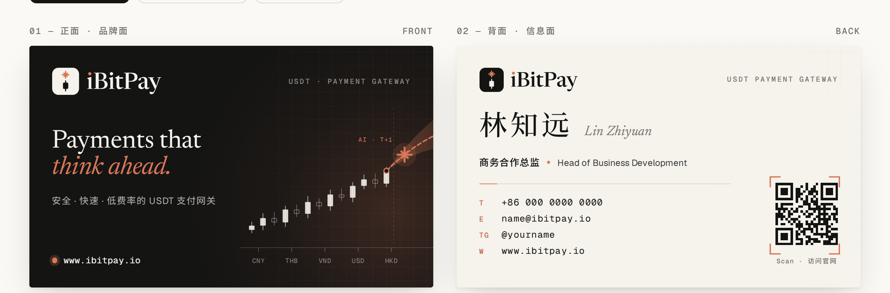

# iBitPay 名片 · Market

为 [www.ibitpay.io](https://www.ibitpay.io) 设计的双面名片。风格参考 claude.com（象牙白底、陶土色点缀、衬线大标题、留白），再加上 K 线、AI 预测曲线、坐标网格和等宽数据字体，让它看起来更有金融和 AI 的感觉。



## 文件

```
Market/
├── business-card.html          # 名片源文件：浏览器打开即可预览、改字、打印 / 导出 PDF
├── export/
│   ├── ibitpay-card-print.pdf  # 印刷文件：2 页（正 / 反），每页 96×60 mm，含 3 mm 出血
│   ├── ibitpay-card-front.png  # 正面（品牌面），成品尺寸 300 dpi
│   ├── ibitpay-card-back.png   # 背面（信息面），成品尺寸 300 dpi
│   └── ibitpay-card-mockup.png # 双面效果图
├── logo/
│   ├── ibitpay-logo.svg / .png            # 横版 Logo（浅色底用）
│   ├── ibitpay-logo-reversed.svg / .png   # 横版 Logo（深色底用）
│   ├── ibitpay-mark.svg                   # 图标（浅色底用）
│   ├── ibitpay-mark-reversed.svg          # 图标（深色底用）
│   └── ibitpay-mark-1024.png              # 图标 1024 px（头像 / App 图标）
├── assets/fonts/               # 本地字体（离线预览和导出用）
└── scripts/                    # 生成 Logo、导出文件的脚本
```

## 设计说明

**Logo（重绘版）**：一个小写的「i」。竖笔是一根 K 线，代表交易和金融；i 上的点换成陶土色火花，代表 AI 和智能；整体也是 iBitPay 的首字母。字标用 Newsreader 衬线体，第一个 i 的点也是陶土色，和图标呼应。所有文字都已转成曲线，SVG 在没有安装字体的电脑上也能正常显示。

> 这个开发环境的网络策略拦截了 ibitpay.io，读不到官网原 Logo，所以 Logo 是按品牌名重新绘制的。要换回原 Logo，把原文件替换到 `logo/` 下的同名文件，再运行导出脚本即可。

**正面（品牌面，墨黑底）**：Logo、标语 *Payments that think ahead.*，以及官网介绍里的「安全 · 快速 · 低费率的 USDT 支付网关」。右侧是象牙色的历史 K 线，末端接着陶土色的 AI 预测虚线和置信区间（AI · T+1）。横轴刻度是 iBitPay 支持的法币：CNY / THB / VND / USD / HKD。

**背面（信息面，象牙白底）**：中英文姓名、职位、联系方式，以及指向 `https://www.ibitpay.io` 的二维码（已验证可以扫描），二维码外加了一圈 AI 识别风格的取景框。

| 色彩 | HEX | 印刷参考（CMYK 近似，以打样为准） |
|---|---|---|
| Ink 墨黑 | `#141413` | 大面积底色建议用四色黑 C60 M40 Y40 K100 |
| Ivory 象牙 | `#F5F3EC` | C3 M3 Y8 K0，或直接用象牙白纸不印底色 |
| Clay 陶土 | `#D97757` | C10 M65 Y70 K0 |
| Stone 石灰 | `#75736B` | C0 M2 Y8 K60 |

字体：Newsreader（衬线）、Geist（正文）、Geist Mono（数据）、Noto Serif SC / Noto Sans SC（中文），均为 SIL OFL 开源授权，可免费商用。

## 修改名片内容

> ⚠️ 姓名「林知远 / Lin Zhiyuan」、职位、电话、邮箱、Telegram 都是**示例占位**，印刷前请换成真实信息。

**方法一（最简单）**：用 Chrome 打开 `business-card.html`，直接点卡片上的文字修改（会自动保存在本机浏览器里），然后点「打印 / 导出 PDF」。在打印对话框里选择「另存为 PDF」，边距选「无」，缩放 100%，并勾选「背景图形」。

**方法二（改源文件并重新导出）**：在 `business-card.html` 里修改带 `data-key` 的元素，然后运行：

```bash
python3 Market/scripts/fetch_cjk_subset.py   # 改了中文时运行：重新生成中文字体子集
npm i -D playwright                          # 首次使用
node Market/scripts/export.cjs               # 重新生成 export/ 下的 PDF 和 PNG，以及 logo PNG
```

修改 Logo 图形：编辑 `scripts/build_logo.py` 后运行 `pip install fonttools uharfbuzz && python3 Market/scripts/build_logo.py`。

## 印刷参数

- 成品尺寸 90 × 54 mm（国内标准名片），四边出血 3 mm，文件尺寸 96 × 60 mm
- 文字和二维码都在距离裁切线 4 mm 以内的安全区里（页面上点「显示出血与安全区」可以查看）
- 建议用 350g 以上的象牙白艺术纸或黑卡纸；Logo 和陶土色部分可以做烫金或烫铜工艺
