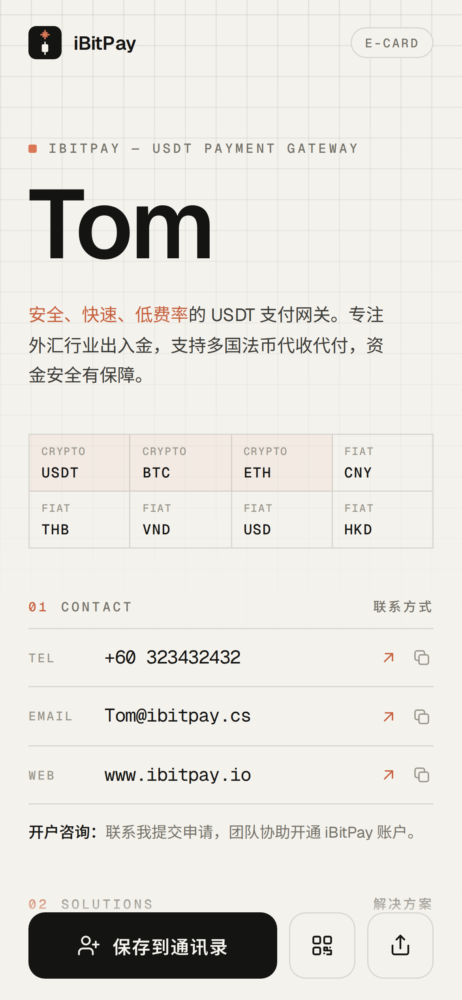
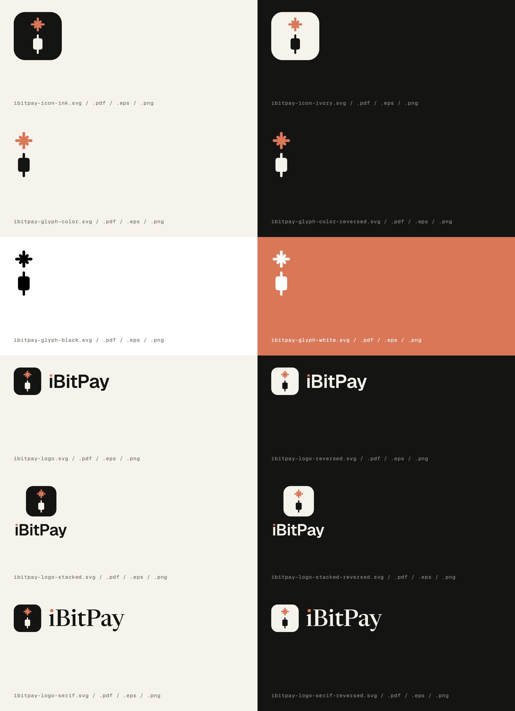

# iBitPay 电子名片 · Market

为 [www.ibitpay.io](https://www.ibitpay.io) 设计的电子名片（手机 H5 页面）和一整套 Logo 矢量文件。

<p>
  
  
</p>

## 文件

```
Market/
├── ecard.html                    # 电子名片：手机浏览器打开即可使用
├── export/
│   ├── ibitpay-ecard-screen.png  # 名片首屏截图（1170×2532，发微信 / 朋友圈）
│   └── ibitpay-ecard-long.png    # 名片完整长图
├── logo/
│   ├── svg/  pdf/  eps/  png/    # 12 款 Logo × 4 种格式（见下表）
│   └── ibitpay-logo-overview.png # Logo 总览图
├── assets/                       # 字体（Geist / Geist Mono / Noto Sans SC 子集）和二维码库
└── scripts/                      # 生成 Logo、导出图片、更新中文字体子集的脚本
```

## 电子名片 `ecard.html`

极简浅色风格：象牙白底、顶部精确网格、超大字号姓名、等宽数据字体，陶土色只做点缀。

页面内容整理自 ibitpay.io 官网：
- **定位**：安全、快速、低费率的 USDT 支付网关，专注外汇行业出入金，支持多国法币代收代付
- **支持币种**：BTC / ETH / USDT，法币 CNY / THB / VND / USD / HKD
- **解决方案**：商户、承兑商系统、开发者 API
- **支付流程**：发起收款 → 智能匹配承兑商 → 用户支付 → 即时到账
- **开户咨询**：联系提交申请，团队协助开通

> 开发环境的网络策略拦截了 ibitpay.io，以上内容取自搜索引擎收录的官网首页。中文措辞可能和官网原文略有出入，建议对照官网核对一遍。

功能：

- **底部操作栏**始终可见：保存到通讯录、跳到二维码、分享
- **保存到通讯录**：一键生成并下载 vCard（.vcf），手机上打开即可存为联系人
- **一键拨号 / 发邮件 / 打开官网**，每一项都可以一键复制
- **扫一扫**：可切换两种二维码。「名片」码用手机相机扫描后直接保存联系人，「官网」码打开 www.ibitpay.io。两种码都已实测可以正确识别
- **分享**：手机上调用系统分享面板；不支持时自动复制链接
- 适配刘海屏安全区；系统开启「减少动态效果」时自动关闭动画

### 修改名片信息

打开 `ecard.html`，只需修改 `<script>` 开头的 `CARD` 配置。留空（`""`）的项目不会显示，也不会写进联系人文件：

```js
const CARD = {
  name:     "Tom",
  nameAlt:  "",                  // 可选：第二个名字（中文名 / 英文名）
  title:    "",                  // 可选：职位，如 "商务总监 · Head of BD"
  org:      "iBitPay",
  phone:    "+60 323432432",
  email:    "Tom@ibitpay.cs",
  telegram: "",                  // 可选：Telegram 用户名，不带 @
  website:  "https://www.ibitpay.io",
};
```

页面上的文字、拨号链接、vCard 和二维码都会根据这份配置自动生成。改完后：

```bash
python3 Market/scripts/fetch_cjk_subset.py   # 改了中文时运行：更新中文字体子集
npm i -D playwright                          # 首次使用
node Market/scripts/export.cjs               # 重新生成 export/ 下的名片截图
```

### 发布

把整个 `Market/` 文件夹放到任意静态网站托管（GitHub Pages、Vercel、Netlify、OSS / COS 等），就能用 `https://你的域名/ecard.html` 分享。每位同事复制一份 `ecard.html`、改好 `CARD` 配置即可，例如 `ecard-tom.html`。

## Logo 矢量文件

图形含义：一个小写的「i」。竖笔是一根 K 线，代表交易和金融；i 上的点是陶土色火花，代表 AI 和智能；整体也是 iBitPay 的首字母。

所有文件都是**纯填充路径**：没有描边，文字也已转成曲线。在 Illustrator、Figma、Sketch、CorelDRAW 里打开效果一致，不需要安装字体，可以任意缩放。PDF 可以直接用 Illustrator 打开编辑（AI 格式本身基于 PDF）。

| 文件名 | 用途 |
|---|---|
| `ibitpay-icon-ink` | 图标，深色方块底（App 图标、头像、浅色背景） |
| `ibitpay-icon-ivory` | 图标，浅色方块底（深色背景） |
| `ibitpay-glyph-color` | 纯图形，无底色：陶土火花 + 墨黑 K 线（浅色背景） |
| `ibitpay-glyph-color-reversed` | 纯图形，无底色：陶土火花 + 象牙 K 线（深色背景） |
| `ibitpay-glyph-black` / `-white` | 单色版（烫印、雕刻、单色印刷） |
| `ibitpay-logo` / `-reversed` | 横版组合，无衬线字标（主推，科技感） |
| `ibitpay-logo-stacked` / `-reversed` | 竖版组合（开屏页、海报、方形位） |
| `ibitpay-logo-serif` / `-reversed` | 横版组合，衬线字标（备选，偏编辑 / 品牌感） |

每款都有 `svg/`、`pdf/`、`eps/`、`png/` 四种格式。PNG 为透明底，图标 1024 px 高，组合 512 px 高。

| 色彩 | HEX | CMYK（近似，以打样为准） |
|---|---|---|
| Ink 墨黑 | `#141413` | C60 M40 Y40 K100 |
| Ivory 象牙 | `#F5F3EC` | C3 M3 Y8 K0 |
| Clay 陶土 | `#D97757` | C10 M65 Y70 K0 |

修改 Logo 图形：编辑 `scripts/build_logo.py`，然后运行：

```bash
pip install fonttools uharfbuzz cairosvg
python3 Market/scripts/build_logo.py
```

> 注：开发环境的网络策略拦截了 ibitpay.io，读不到官网原 Logo，这套 Logo 是按品牌名重新绘制的。

## 字体与授权

Geist、Geist Mono、Newsreader（衬线字标）、Noto Sans SC，均为 SIL Open Font License，可免费商用。二维码库为 [qrcode-generator](https://github.com/kazuhikoarase/qrcode-generator)（MIT）。
